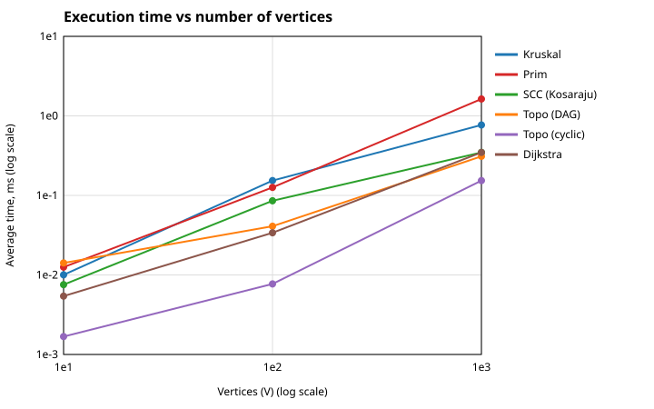
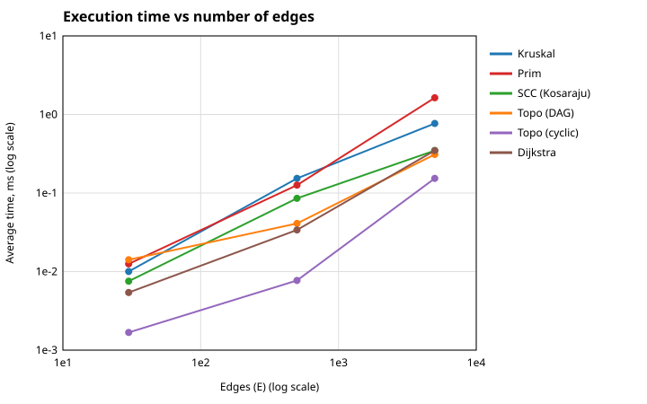

# Assignment 3 — Smart City Infrastructure and Route Planning

## Overview
A Java application that models a city as a graph and solves three planning tasks:
1. **Infrastructure planning** – Minimum Spanning Tree (Kruskal + DSU, Prim + priority queue).
2. **Connectivity analysis** – topological ordering (Kahn) and Strongly Connected Components (Kosaraju).
3. **Route planning** – shortest paths (Dijkstra).

**Graph model:** vertices = districts (`0..n-1`), edges = roads, weights = construction cost / distance (integers 1..100).
**Representation:** adjacency list (`List<List<Edge>>`) plus a flat edge list (`Graph`). Undirected edges are stored in both directions in the adjacency list and once in the edge list.

```
assignment-3/
├── src/
│   ├── graph/         Edge, Graph, GraphGenerator
│   ├── dsu/           DSU
│   ├── mst/           Kruskal, Prim, MSTResult
│   ├── connectivity/  TopologicalSort, SCC
│   ├── shortestpath/  Dijkstra
│   ├── Main.java, Benchmark.java, Tests.java, PlotWriter.java
├── results/
│   ├── tables/        results.md, results.csv
│   └── plots/         time_vs_vertices.svg, time_vs_edges.svg
└── README.md
```

**Run:** open `src` as a source root in IntelliJ IDEA (Java 17+), run `Main`. Working directory must be the project root. `Main` runs tests, a demo and all experiments, and rewrites `results`.

## Implementation
- **DSU:** `find` with iterative path compression, `union` by rank. Both optimisations can be switched off (constructor flags) only to measure their effect. Counters: `finds`, `findSteps` (parent hops), `unions`.
- **Kruskal:** sort edges by weight, `union` joins two components → edge is in the MST. Stops after `V-1` edges. Disconnected graph → `connected = false`, result is a minimum spanning forest.
- **Prim:** binary heap `PriorityQueue`, lazy deletion (outdated entries are skipped). Restarts from every unvisited vertex, so on a disconnected graph it also returns a forest and the weights stay comparable with Kruskal.
- **Topological sort:** Kahn's algorithm (in-degree queue). If fewer than `V` vertices are output, a cycle exists → returns `isDag = false`.
- **SCC:** Kosaraju. DFS on the graph (finish order), build reversed graph, DFS in reverse finish order. Each tree of the second pass is one SCC.
- **Dijkstra:** binary heap with lazy deletion, `long` distances, `INF = Long.MAX_VALUE` for unreachable vertices, `prev[]` for paths. Throws `IllegalArgumentException` on a negative weight.

**Why Dijkstra fails with negative weights:** it assumes that once a vertex is taken from the heap its distance is final, because any other path can only be longer. A negative edge breaks this: a longer path through a negative edge can later become shorter, but the vertex is already finalised and is never updated. (Bellman-Ford handles this case.)

## Complexity Analysis
Assumptions: adjacency list, binary heap, `V` vertices, `E` edges.

| Algorithm | Time | Space | Effect of V and E |
|---|---|---|---|
| DSU `find` / `union` (compression + rank) | O(α(V)) amortised per operation (practically constant) | O(V) | Independent of E; grows with number of operations |
| Kruskal | O(E log E) = O(E log V) (sorting dominates) + O(E α(V)) | O(V + E) | Mostly depends on E (sorting) |
| Prim (binary heap) | O(E log V) | O(V + E) | Each edge can cause one heap push, each push costs O(log V) |
| Topological sort (Kahn) | O(V + E) | O(V) | Linear in both |
| SCC (Kosaraju) | O(V + E) (two DFS + reversing) | O(V + E) (reversed graph) | Linear in both |
| Dijkstra | O((V + E) log V) = O(E log V) when E ≥ V | O(V + E) | Each successful relaxation pushes to the heap |

Without optimisations DSU `find` is O(V) in the worst case (long chain). Compression alone gives O(log V) amortised, rank alone gives O(log V) worst case; together O(α(V)).

## Experimental Setup
- **Sizes:** Small (V=10, E=30), Medium (V=100, E=500), Large (V=1000, E=5000).
- **Seed:** fixed `42` → identical graphs in every run. Weights: random integers 1..100.
- **Undirected (MST):** random spanning tree first (each vertex `v` linked to a random earlier vertex → always connected), then random extra edges until `E` is reached. No self-loops, no duplicate edges.
- **Directed (SCC, Topo-cyclic, Dijkstra):** `E` random distinct edges `u→v`, `u ≠ v`. **Contains cycles** (SCC counts in the results: 1, 1, 18).
- **DAG (Topo-DAG):** hidden random vertex order, every edge goes from the earlier to the later vertex → **acyclic by construction**.
- **Measurement:** 300 warm-up runs (JIT), then **5 timed runs**, average via `System.nanoTime()`, in ms. Graph generation is not timed.
- **Operation counters:** Kruskal: edges examined + DSU ops (`finds + parent hops + unions`). Prim: adjacency entries examined + heap ops (push + poll). SCC/Topo: edge examinations. Dijkstra: edge checks + heap ops.
- Times depend on the machine; operation counts are deterministic.

## Results
Full output: `results`, `../results`.

### MST: Kruskal vs Prim
| Algorithm | V | E | Avg time (ms) | MST weight | Edge checks | DSU ops / heap ops |
|---|---|---|---|---|---|---|
| Kruskal | 10 | 30 | 0.0027 | 129 | 14 | 53 |
| Prim | 10 | 30 | 0.0034 | 129 | 60 | 62 |
| Kruskal | 100 | 500 | 0.0503 | 1170 | 164 | 679 |
| Prim | 100 | 500 | 0.0787 | 1170 | 1000 | 1002 |
| Kruskal | 1000 | 5000 | 0.3576 | 13123 | 3356 | 13932 |
| Prim | 1000 | 5000 | 0.8062 | 13123 | 10000 | 10002 |

### SCC (Kosaraju)
| V | E | Avg time (ms) | SCC count | Edge examinations |
|---|---|---|---|---|
| 10 | 30 | 0.0057 | 1 | 90 |
| 100 | 500 | 0.0245 | 1 | 1500 |
| 1000 | 5000 | 0.1572 | 18 | 15000 |

### Topological ordering
| Graph | V | E | Avg time (ms) | Is DAG | Edge examinations |
|---|---|---|---|---|---|
| DAG | 10 | 30 | 0.0049 | yes | 60 |
| Cyclic | 10 | 30 | 0.0005 | no | 30 |
| DAG | 100 | 500 | 0.0118 | yes | 1000 |
| Cyclic | 100 | 500 | 0.0049 | no | 500 |
| DAG | 1000 | 5000 | 0.1580 | yes | 10000 |
| Cyclic | 1000 | 5000 | 0.0601 | no | 5054 |

### Dijkstra (source 0)
| V | E | Avg time (ms) | Reachable | Edge checks | Heap ops |
|---|---|---|---|---|---|
| 10 | 30 | 0.0021 | 10 | 30 | 24 |
| 100 | 500 | 0.0326 | 100 | 500 | 300 |
| 1000 | 5000 | 0.2050 | 990 | 4946 | 2840 |

### DSU: effect of the optimisations
Inside Kruskal (V=1000, E=5000):

| Variant | find calls | parent hops | hops per find |
|---|---|---|---|
| No optimisation | 6712 | 492169 | 73.327 |
| Path compression only | 6712 | 12549 | 1.870 |
| Union by rank only | 6712 | 11054 | 1.647 |
| Compression + rank | 6712 | 6221 | 0.927 |

Stress test (build a chain of 1000 elements, then `find(0)` 1000 times):

| Variant | find calls | parent hops | hops per find |
|---|---|---|---|
| No optimisation | 2998 | 999000 | 333.222 |
| Path compression only | 2998 | 1998 | 0.666 |
| Union by rank only | 2998 | 1997 | 0.666 |
| Compression + rank | 2998 | 1997 | 0.666 |

### Plots (log-log)



## Comparison and Discussion
- **Kruskal vs Prim:** both give the same MST weight on every graph (129 / 1170 / 13123). Both are O(E log V), but here Kruskal is faster (0.36 ms vs 0.81 ms on the large graph). Kruskal stops after the tree is complete and examined only 3356 of 5000 edges, while Prim looks at every adjacency entry (2E = 10000) and does ~E heap operations with `int[]` allocations. Prim usually wins on dense graphs; at E ≈ 5V (sparse) Kruskal is competitive or better.
- **DSU:** without optimisations a `find` takes ~73 hops on average on the large graph, because unions create tall trees. Path compression flattens a path after each `find`; union by rank keeps trees shallow (height ≤ log V). Compression + rank together are the best (0.93 hops per find). The chain test shows the worst case: 333 hops per find without optimisations vs 0.67 with either one.
- **SCC:** edge examinations are exactly `3E` (two DFS passes + building the reversed graph): 90 → 1500 → 15000. Time grows roughly linearly with `V + E` (0.006 → 0.025 → 0.157 ms), as O(V + E) predicts. The 1000-vertex graph has 18 SCCs (one big component + singletons).
- **Topological sort:** a DAG needs `2E` examinations (count in-degrees + process edges). A cyclic graph is cheaper: the queue runs empty early (5054 of 10000 on the large graph), so the cycle is detected without visiting everything.
- **Dijkstra:** edge checks ≤ E; time grows from 0.002 to 0.205 ms as the graph grows 100× in size. Only 990 of 1000 vertices were reachable in the large directed graph (the rest are reported as unreachable). Heap operations (2840) are far fewer than edges (5000) because only successful relaxations push to the heap.
- **Theory vs experiment:** operation counts match the theory exactly (linear for SCC/Topo, ≈ E log V behaviour for heap algorithms). Absolute times are small and noisy (JIT, GC); the small graph runs in microseconds, so its timings are less reliable than the counters.
- **Plots:** V and E grow together in these configurations (×10 in V, ×10–17 in E), so the two plots look similar; all curves rise roughly linearly on the log-log scale, i.e. near-linear growth.

## Testing
`Tests.java` (plain Java, no libraries; 11 618 checks, all pass):
- **Single vertex:** MST weight 0 and connected, topological sort OK, 1 SCC, Dijkstra distance 0.
- **Disconnected graph:** both MST algorithms report `connected = false` and the same forest weight.
- **Cycle in undirected graph (triangle)** and **multiple valid MSTs (square with equal weights):** Kruskal = Prim.
- **Duplicate weights:** 200 random connected graphs (half with weights only 1..3): Kruskal weight == Prim weight, exactly `V-1` edges.
- **DSU:** separate sets at start, union, same set, union of the same set returns false.
- **Topological sort:** 50 random DAGs → order contains all vertices and every edge goes forward; a 3-cycle is detected as "no topological order".
- **SCC:** known example (`{0,1,2}`, `{3,4}`); 50 random graphs: every vertex is in exactly one SCC, and two vertices share a SCC **iff** they reach each other (checked against Floyd-Warshall).
- **Dijkstra:** 50 random graphs × 15 sources compared with Floyd-Warshall (including unreachable vertices); path endpoints; unreachable vertex has empty path; negative weight is rejected.

## Conclusion
- **MST:** Kruskal (with DSU) is simple and fast on sparse graphs; Prim is a good choice for dense graphs or when the graph is already an adjacency list. Both return the same weight.
- **DSU:** always use path compression + union by rank; it removes the long-chain worst case.
- **Topological sort / SCC:** both are linear O(V + E). Use Kahn to order dependencies and to detect cycles; use Kosaraju (or Tarjan) to find groups of mutually reachable locations.
- **Shortest paths:** Dijkstra is the right tool for non-negative weights (roads, distances); with negative weights use Bellman-Ford.
